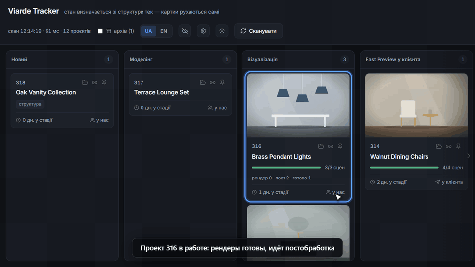
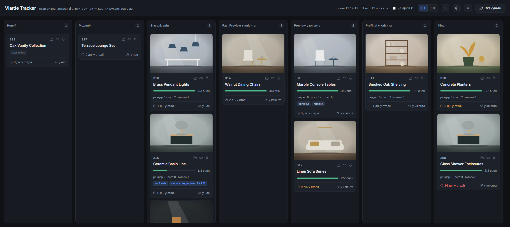
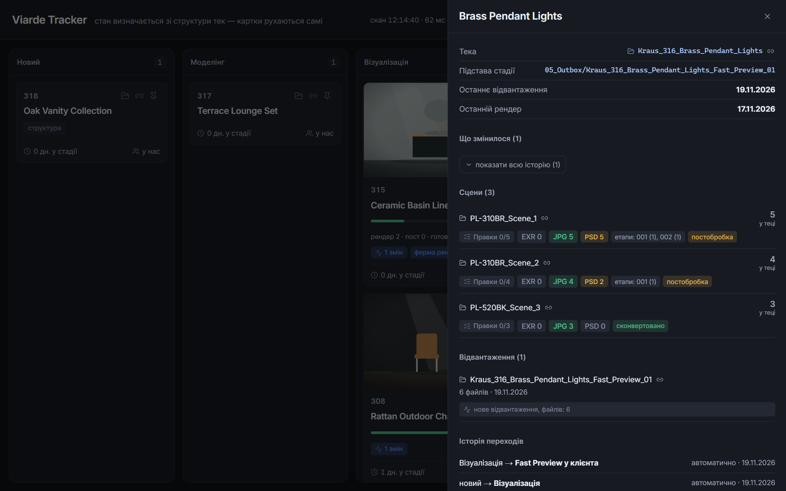
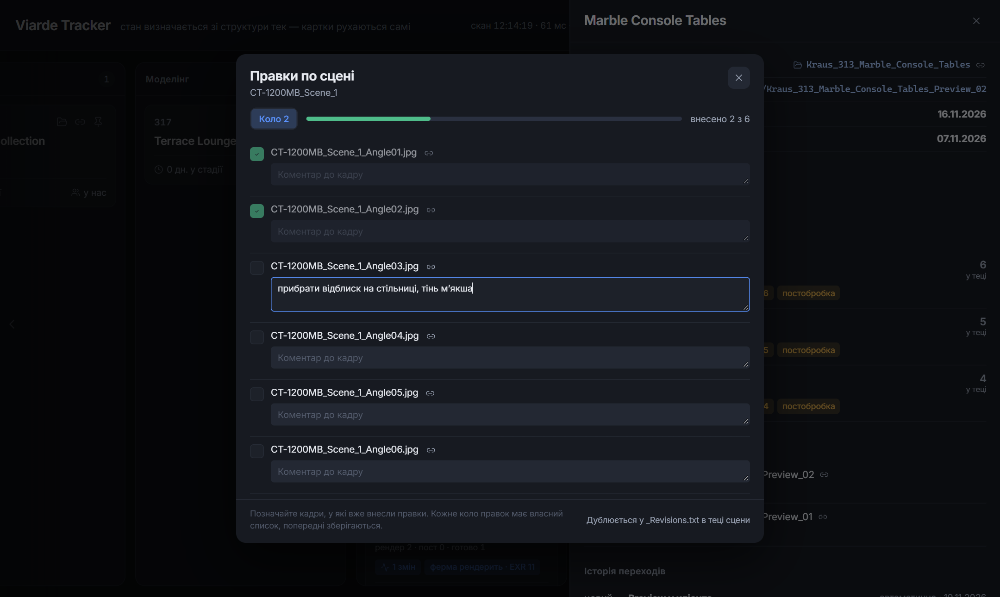
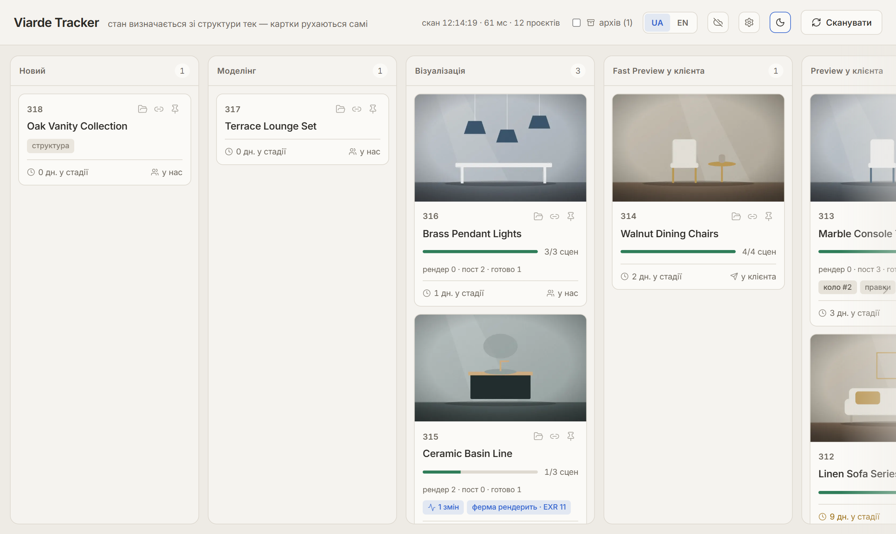

# Viarde Tracker

Канбан-доска проектов студии визуализации, которую никто не двигает руками.
Трекер смотрит, что лежит в папках проектов в Dropbox, и сам ставит карточку
в нужную колонку: рендерится, отправлено клиенту на превью, сдан финал.



На всех снимках — демо-данные: проекты и картинки выдуманы.

## Что это даёт

- **Статус проекта не нужно вести.** Положили картинки в `05_Outbox/…_Preview_02` —
  карточка уехала в «Preview у клиента», на ней появилась отметка «круг №2».
- **Видно, у кого мяч.** «У нас» — идёт работа. «У клиента» — отправили и ждём ответа.
- **Видно, что застряло.** Карточка желтеет, если проект стоит в стадии 5 дней,
  и краснеет после 14.
- **Видно, что изменилось.** Пришли новые EXR с фермы, добавились картинки,
  появилась отгрузка — всё это попадает в журнал проекта.

## Как это выглядит

Доска целиком — семь колонок, от нового проекта до финала:



Карточка проекта — основание стадии, сцены с количеством EXR, JPG и PSD,
отгрузки и история переходов:



Чеклист правок — по каждой сцене список кадров с галочками и заметками,
отдельный на каждый круг правок:



Светлая тема. Язык интерфейса — украинский или английский, переключается в шапке:



## Как трекер понимает стадию

Он читает стандартную структуру папки проекта:

```
Kraus_316_Brass_Pendant_Lights/
  01_Clients/      бриф, таблица-план, правки клиента
  03_Models/       модели
  04_EXR/          сырые рендеры с фермы, по папке на сцену
  04_JPG/          сконвертированные картинки, по папке на сцену
  04_PSD/          постобработка
  05_Outbox/       то, что отправлено клиенту
    Kraus_316_Brass_Pendant_Lights_Fast_Preview_01/
    Kraus_316_Brass_Pendant_Lights_Preview_02/
```

| Колонка | Когда карточка в ней |
|---|---|
| Новий | есть только бриф, папки `03_Models` ещё нет |
| Моделінг | папка моделей есть, рендеров ещё нет |
| Візуалізація | в сценах есть EXR, JPG или PSD, и они свежее последней отгрузки |
| Fast Preview / Preview / Prefinal у клієнта | последняя непустая папка в `05_Outbox` этого вида, и после неё не рендерили |
| Фінал | последняя отгрузка — `Final`; через 60 дней тишины карточка уходит в архив |

Стадия считается по самому свежему событию. Если после превью пошли новые
рендеры, карточка возвращается в «Візуалізацію» — мяч снова у студии.

Дерево папок трекер получает от Dropbox по сети, а не обходом диска, и
обновляет его по сигналу об изменениях. Поэтому доска работает и для проектов,
которые не скачаны на компьютер.

## Установка

Нужны Windows 10 или 11 (64-бит) и свободный порт 3000. Node, базы данных и
прочее ставить не нужно — всё внутри установщика.

1. Запустите `ViardeTrackerSetup-<версия>.exe`. Права администратора не нужны.
2. В области уведомлений появится значок трекера, в браузере откроется доска:
   `http://localhost:3000`.
3. Нажмите значок облака в шапке и войдите в Dropbox. Вводить ключи и пароль
   в сам трекер не нужно — вход идёт на странице Dropbox.
4. Нажмите шестерёнку и отметьте проекты, за которыми следить.
5. Там же укажите, где на этом компьютере лежит папка Dropbox. Это нужно только
   для кнопки «открыть папку в проводнике» и для файла чеклиста в папке сцены.

Готового установщика в репозитории нет: он собирается командой из раздела
[«Для разработчиков»](#для-разработчиков).

Что полезно знать:

- **Значок в трее.** В его меню — открыть доску, открыть папку данных с журналом,
  выйти. Пока трекер запущен, он записывает переходы; пока выключен — нет.
  Поэтому установщик предлагает запускать его вместе с Windows.
- **Данные** лежат в `%LOCALAPPDATA%\ViardeTracker`: история переходов, чеклисты,
  вход в Dropbox. Удаление программы эту папку не трогает.
- **Доска открывается только с этого компьютера.** Входа с паролем в трекере нет,
  поэтому в сеть он не смотрит.

## Что ещё умеет

- Закрепить карточку в колонке вручную — до следующей отгрузки.
- Сверить готовые кадры с таблицей-планом клиента из `01_Clients`.
- Открыть папку проекта, сцены или отгрузки в проводнике и скопировать ссылку
  на неё в Dropbox.
- Показать отклонения от конвенции имён: пробелы в названии, пустая папка
  отгрузки, сцена без артикула.

## Ограничения

- Только Windows.
- Папки проектов должны называться по конвенции студии: `Kraus_<номер>_<название>`.
  Правила разбора имён собраны в [src/config.ts](src/config.ts).
- История у каждого компьютера своя: переходы и чеклисты между компьютерами
  не синхронизируются.
- Комментарии клиента к картинкам из Dropbox получить нельзя — это проверено,
  итог в [COMMENTS_RESEARCH.md](COMMENTS_RESEARCH.md).

## Для разработчиков

Запуск из исходников (Node 22, версия в `.node-version`):

```bash
npm install
npm run dev      # http://localhost:3000
```

Для входа в Dropbox нужен ключ своего приложения Dropbox в `.env.local` —
шаги в [docs/DEVELOPMENT.md](docs/DEVELOPMENT.md#подключение-dropbox).

Сборка самостоятельной папки и установщика:

```bash
node scripts/pack.mjs
```

Результат — `dist/ViardeTracker` (программа вместе с Node) и
`dist/ViardeTrackerSetup-<версия>.exe`. Установщик собирается, если на машине
стоит [Inno Setup 6](https://jrsoftware.org/isinfo.php); без него получится
только папка, которую можно перенести и запустить как есть.

Как устроен скан, модель стадий, защита API и структура кода —
в [docs/DEVELOPMENT.md](docs/DEVELOPMENT.md). Решения по переходу на Dropbox API —
в [docs/PLAN-DROPBOX-API.md](docs/PLAN-DROPBOX-API.md).
